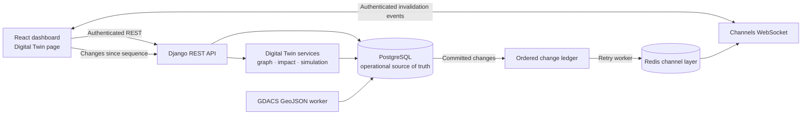
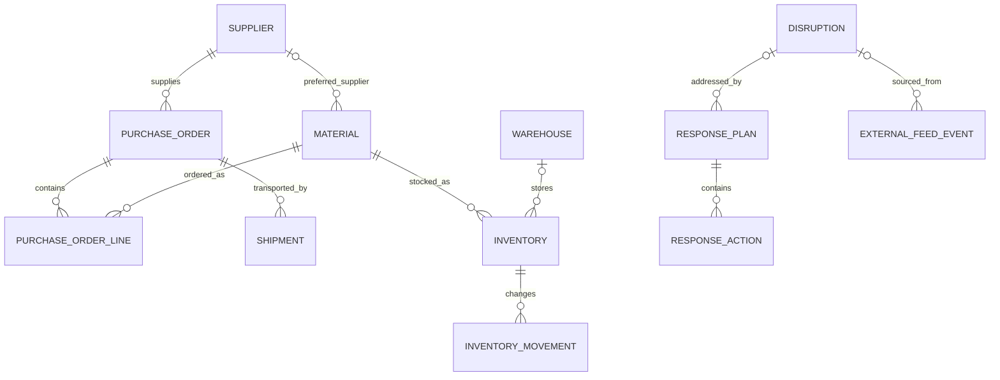

# ARES supply-chain digital twin

The digital twin is an authenticated view and analysis layer over existing ARES records. PostgreSQL remains the source of truth. The module derives graph and geographic snapshots at request time; it does not copy operational entities into a second graph database.

## Architecture



The Django module is `backend/supply_chain/digital_twin/`. It reuses the current models, API token authentication, DRF error handling, Channels/Redis, React, Leaflet, and MapLibre dependencies. The network graph is drawn with native SVG; no graph package or other frontend dependency was added.

## Existing entity relationships

These are the stored relationships from which the graph is generated:



ARES has no customer or distribution-destination entity. Shipment origin/destination are text fields, with optional paired coordinates. A shipment is connected to a warehouse only when the endpoint text exactly matches a unique warehouse name or code; ARES does not geocode or guess this relationship. `PurchaseOrder.material` remains as a compatibility field; graph generation uses normalized `PurchaseOrderLine` rows when present and falls back to the legacy header material when no lines exist.

The graph contains supplier, warehouse, material, purchase-order, shipment, and disruption nodes. A material can have multiple map locations from its preferred supplier and inventory warehouses. A shipment can have separate origin and destination locations. Nodes report unavailable geography when source coordinates are absent. Inventory balances are represented in `stores` edge metadata, not duplicated as graph nodes. Shipment endpoint lines connect only the two recorded endpoints; the model has no verified carrier route geometry, so these lines are not presented as actual paths.

## Graph generation and API

`build_graph()` reads the current database and constructs typed nodes/edges. Edge metadata records the underlying relationship, quantities, and matching basis. Node status and risk level are separate fields. For example, a disruption can remain `open` while its risk level is `critical` because its source severity is high.

All listed endpoints require an authenticated ARES account. Collection endpoints accept `page` and `page_size`; the maximum page size is 500. Graph filters accept comma-separated `type`, `status`, `risk_level`, and a `search` string.

| Endpoint | Purpose |
| --- | --- |
| `GET /api/digital-twin/graph/` | Paginated node snapshot with edges touching that page |
| `GET /api/digital-twin/nodes/` | Independently filtered and paginated nodes |
| `GET /api/digital-twin/edges/` | Independently filtered and paginated relationships; supports `edge_type`, `source`, and `target` |
| `GET /api/digital-twin/entities/{type}/{uuid}/` | Entity detail plus direct links and neighboring entities |
| `GET /api/digital-twin/geo/` | GeoJSON for recorded facilities, shipment endpoints/direct connectors, and current disruption geometry |
| `GET /api/digital-twin/health/` | Database-derived supply-chain KPIs and missing-coordinate counts |
| `GET /api/digital-twin/impacts/{disruption-uuid}/` | Classifications, reasons, and geographic policy used for a disruption |
| `GET /api/digital-twin/dependencies/{type}/{uuid}/?direction=upstream\|downstream\|all` | Direct dependencies of an entity |
| `POST /api/digital-twin/simulations/` | Validate, run, and persist an isolated what-if scenario |
| `GET /api/digital-twin/simulations/` | Paginated simulations owned by the account; staff can review all |
| `GET /api/digital-twin/simulations/{simulation-uuid}/` | Retrieve a stored simulation result |
| `GET /api/digital-twin/sync/status/` | Latest sequence, latest change/publish time, pending live deliveries, and external-feed status/last-success times |
| `GET /api/digital-twin/changes/?since={sequence}&limit=100` | Ordered recovery events after a client cursor (limit 1–500) |

Example graph query: `GET /api/digital-twin/graph/?type=supplier,shipment&risk_level=critical&search=port&page=1&page_size=100`.

## Geographic impact methodology

The impact endpoint returns one of `confirmed_affected`, `geographically_exposed`, `potentially_impacted`, `unaffected`, or `insufficient_information` for each graph node, with a reason for every result. The map supports record search/type filters; selecting a GDACS disruption marker opens the same impact analysis used by the graph inspector.

- `confirmed_affected` means the disruption record explicitly links an affected supplier or shipment; it does not mean ARES independently verified a hazard impact.
- `geographically_exposed` means recorded entity coordinates intersect a GDACS-provided polygon/multipolygon (or lie within its configured buffer), or fall within a severity/type distance threshold around a point event.
- `potentially_impacted` is propagated across recorded dependency links from explicitly linked or geographically exposed entities.
- `unaffected` means available coordinates are outside the analyzed area and no dependency path was found.
- `insufficient_information` is used when required entity coordinates or disruption geometry/coordinates are missing.

Country and region strings are never used to infer exposure. GDACS polygon and multipolygon geometry is retained from the source; point distance thresholds are policy buffers, not measured hazard radii. Configure `ARES_DIGITAL_TWIN_EXPOSURE_THRESHOLDS_KM` as a JSON object keyed by hazard type and severity (`low`, `medium`, `high`, `critical`); use a `default` key for hazard types without an override. The shipped defaults are broad starting values, not scientific hazard boundaries, and should be calibrated by the demonstration operator. Values must be between 0 and 5,000 km.

Example source-provided flood walkthrough:

1. Add or import a warehouse/supplier with its actual latitude and longitude. Leave either field pair blank when the location is unknown.
2. Sync GDACS with `python manage.py sync_gdacs_alerts`; current GeoJSON boundaries are retained with their source event when GDACS supplies them.
3. Open **Supply chain digital twin**, select the active flood disruption, then choose **Analyze impact**.
4. Review the map and the classification counts. A facility inside the source boundary is geographically exposed; its materials, open purchase orders, and shipments can be marked potentially impacted only when ARES has the corresponding stored dependency links.
5. Read each entity's explanation and missing-data reason before creating response work. A same-country record with no coordinate is not called affected.

This is a procedure, not a claim that any particular current ARES record is exposed to a real flood.

## Simulations

Supported scenarios are supplier failure, warehouse failure, shipment delay, route disruption, material shortage, and demand surge. Example request:

```json
{
  "scenario_type": "shipment_delay",
  "entity_id": "<existing-shipment-uuid>",
  "horizon_days": 30,
  "delay_days": 7
}
```

The returned result is explicitly labeled `SIMULATED` and is saved under its own simulation ID. The engine reads current inventory, dated issue movements, open purchase-order quantities, shipment status, and known dates into a calculation snapshot. It does not save changes to inventory, POs, shipments, suppliers, or warehouses. Results include baseline and simulated horizon-end availability, material-level consequence text, and shifted ETA details for shipment-delay scenarios. Intermediate day-by-day stockout timing is not modeled.

Shipment records do not allocate quantities to purchase-order lines. For a shipment-delay/route scenario, ARES therefore treats the linked PO's outstanding quantity as carried by that shipment; if multiple shipments link to the PO, the output warns that this assumption may overstate the affected quantity. Inbound orders with no usable expected date/ETA are excluded from quantitative horizon projections and identified as a data gap. Warehouse destination matching is exact; unresolved inbound destination is not assigned to the failed warehouse. Demand-surge impact is quantified only after at least 60 days of movement history and 10 distinct issue dates; otherwise the result says it is insufficiently supported.

The `route_disruption` scenario currently applies a selected `delay_days` value to one shipment, like `shipment_delay`; ARES has no saved carrier route geometry or alternate-route model. It does not calculate a reroute or derive a delay from the GDACS boundary.

## Synchronization and recovery

Signals append a monotonically increasing `DigitalTwinChangeEvent` for changes to suppliers, warehouses, materials, inventory/movements, POs/lines, shipments, disruptions, external-feed records, response plans/actions, and action executions. After database commit, the existing authenticated Channels group receives resource/action/sequence metadata; record contents remain behind the authenticated API.

If a channel publish fails, its sequence stays pending. The Compose `digital-twin-retry-worker` retries pending events, and the authenticated `changes` endpoint lets clients recover by sequence after reconnect. Clients should process each sequence once, advance the cursor only after applying it, and refetch the graph/data snapshot when an event arrives. The dashboard continues using the existing 30-second fallback refresh. Sync status includes the digital-twin change time, pending delivery count, and source-feed status/last-success times; the page shows both the latest record change and GDACS sync time.

Run the retry loop locally without Compose from `backend/`:

```sh
python manage.py retry_digital_twin_events --watch --interval 10
```

## Setup and verification

Apply the additive migration before using new APIs:

```sh
cd backend
python manage.py migrate
```

The local Compose demo applies migrations automatically on startup and starts the retry worker. Add coordinates through the authenticated Supplier/Warehouse/Disruption forms/API or the optional CSV fields documented in [data imports](../product/data-imports.md). Current records are not assigned estimated coordinates. The OpenFreeMap basemap requires outbound HTTPS access from the browser.

Backend tests are in `backend/supply_chain/tests/`; run them with `python manage.py test supply_chain.tests` in a configured environment. Frontend tests run with `pnpm test` from `frontend/`, and the production bundle builds with `pnpm build`.

Screenshots are intentionally not embedded in this source guide: a verified authenticated page capture requires a running backend, migrated database, and actual records. Capture the graph, map, impact panel, and simulation result from the local demo after supplying real data; do not use illustrative/fabricated records as production evidence.
