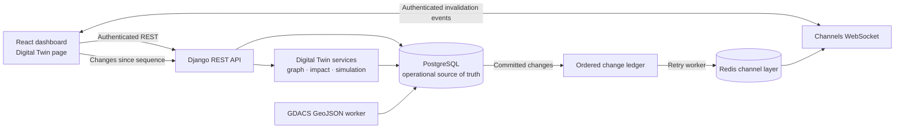
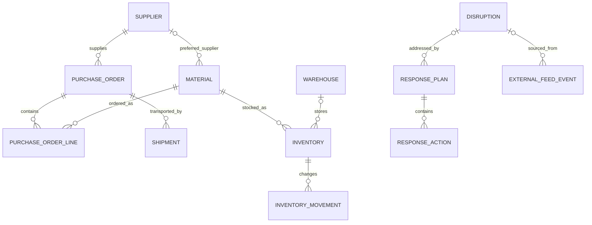

# ARES supply-chain digital twin

The digital twin is an authenticated view and analysis layer over existing ARES records. PostgreSQL remains the source of truth. The module derives graph and geographic snapshots at request time; it does not copy operational entities into a second graph database.

## Architecture



The Django module is `backend/supply_chain/digital_twin/`. It reuses the current models, API token authentication, DRF error handling, Channels/Redis, React, Leaflet, and MapLibre dependencies. The network graph is drawn with native SVG; no graph package or other frontend dependency was added.

## Existing entity relationships

These are the stored relationships from which the graph is generated:



ARES has no customer or distribution-destination entity. Shipment origin/destination are text fields, with optional paired coordinates. A shipment is connected to a warehouse only when the endpoint text exactly matches a unique warehouse name or code; ARES does not geocode or guess this relationship. `PurchaseOrder.material` remains as a compatibility field; graph generation uses normalized `PurchaseOrderLine` rows when present and falls back to the legacy header material when no lines exist.

The graph contains supplier, warehouse, material, purchase-order, shipment, and disruption nodes. A material can have multiple map locations from its preferred supplier and inventory warehouses. A shipment can have separate origin and destination locations and may optionally store a GeoJSON `LineString` or `MultiLineString` plus the source attribution entered by the importer. ARES stores that attribution as provided; it does not verify that the path reflects carrier operations. The World map draws the supplied path as a solid line; endpoint-only connectors are dashed and are not presented as actual carrier routes. ARES never infers routes or facility coordinates. Inventory balances are represented in `stores` edge metadata, not duplicated as graph nodes.

## Graph generation and API

`build_graph()` reads the current database and constructs typed nodes/edges. Edge metadata records the underlying relationship, quantities, and matching basis. Node status and risk level are separate fields. For example, a disruption can remain `open` while its risk level is `critical` because its source severity is high.

All listed endpoints require an authenticated ARES account. Collection endpoints accept `page` and `page_size`; the maximum page size is 500. Graph filters accept comma-separated `type`, `status`, `risk_level`, and a `search` string.

| Endpoint | Purpose |
| --- | --- |
| `GET /api/digital-twin/graph/` | Paginated node snapshot with edges touching that page |
| `GET /api/digital-twin/nodes/` | Independently filtered and paginated nodes |
| `GET /api/digital-twin/edges/` | Independently filtered and paginated relationships; supports `edge_type`, `source`, and `target` |
| `GET /api/digital-twin/entities/{type}/{uuid}/` | Entity detail plus direct links and neighboring entities |
| `GET /api/digital-twin/geo/` | GeoJSON for recorded facilities, supplied shipment paths or endpoint connectors, and current disruption geometry with source metadata |
| `GET /api/digital-twin/health/` | Database-derived supply-chain KPIs and missing-coordinate counts |
| `GET /api/digital-twin/impacts/{disruption-uuid}/` | Classifications, reasons, and geographic policy used for a disruption |
| `GET /api/digital-twin/dependencies/{type}/{uuid}/?direction=upstream\|downstream\|all` | Direct dependencies of an entity |
| `POST /api/digital-twin/simulations/` | Validate, run, and persist an isolated what-if scenario |
| `GET /api/digital-twin/simulations/` | Paginated simulations owned by the account; staff can review all |
| `GET /api/digital-twin/simulations/{simulation-uuid}/` | Retrieve a stored simulation result |
| `GET /api/digital-twin/sync/status/` | Latest sequence, latest change/publish time, pending live deliveries, and external-feed status/last-success times |
| `GET /api/digital-twin/changes/?since={sequence}&limit=100` | Ordered recovery events after a client cursor (limit 1–500) |

Example graph query: `GET /api/digital-twin/graph/?type=supplier,shipment&risk_level=critical&search=port&page=1&page_size=100`.

## Geographic impact methodology

The impact endpoint returns a canonical `exposure_classification`, structured `evidence`, and a human-readable reason for every graph node. It also retains the original `classification` and `counts` fields for API compatibility. Canonical classes are `confirmed_operational_disruption`, `confirmed_geographical_intersection`, `potential_geographical_exposure`, `indirect_supply_chain_dependency`, `unaffected`, and `unknown_insufficient_data`. The map supports record search/type filters; selecting a current GDACS disruption opens the same impact analysis used by the graph inspector.

- `confirmed_operational_disruption` means an operator-entered ARES disruption record explicitly links a supplier or shipment. This is a recorded assertion, not independent field verification or a claim that GDACS proved the impact.
- `confirmed_geographical_intersection` means recorded facility coordinates fall inside a valid source-provided GDACS polygon/multipolygon or a supplied shipment path intersects it.
- `potential_geographical_exposure` means a facility/route is within the configured buffer of a polygon boundary or point event. A point-event radius is a policy distance, not a physical hazard boundary.
- `indirect_supply_chain_dependency` means the entity is connected through stored dependency edges to an explicitly linked or geographically exposed entity; the evidence includes the traversed path.
- `unaffected` means the available coordinates/routes were checked and fell outside the configured exposure area, with no dependency path found.
- `unknown_insufficient_data` is used when required entity coordinates or disruption geometry are missing, or a linked entity has incomplete coordinates.

Country and region strings are never used to infer exposure. GDACS source geometry is validated for supported GeoJSON types, numeric finite WGS84 coordinates, closed polygon rings, and bounded vertex counts before persistence. Unsupported or invalid geometry is retained only as a geometry-status diagnostic and is not drawn or used for impact classification. The feed also retains available event/episode identifiers, lifecycle, timestamps, alert level, allowlisted source metrics, and a GDACS source URL. Lifecycle cancellation/expiry affects source-event history and current map display only; it never automatically closes an ARES disruption or response plan. Configure `ARES_DIGITAL_TWIN_EXPOSURE_THRESHOLDS_KM` as a JSON object keyed by hazard type and severity (`low`, `medium`, `high`, `critical`); use a `default` key for hazard types without an override. The shipped defaults are broad starting values, not scientific hazard boundaries, and should be calibrated by the demonstration operator. Values must be between 0 and 5,000 km.

Example source-provided flood walkthrough:

1. Add or import a warehouse/supplier with its actual latitude and longitude. Leave either field pair blank when the location is unknown.
2. Sync GDACS with `python manage.py sync_gdacs_alerts`; current GeoJSON boundaries are retained with their source event when GDACS supplies them.
3. Open **Supply chain digital twin**, select the active flood disruption, then choose **Analyze impact**.
4. Review source geometry status and the canonical classification counts. A facility inside the source boundary or an imported shipment path intersecting it is a confirmed geographical intersection; proximity buffers remain potential. Its materials, open purchase orders, and shipments can be classified as indirect dependencies only when ARES has the corresponding stored links.
5. Read each entity's explanation and missing-data reason before creating response work. A same-country record with no coordinate is not called affected.

This is a procedure, not a claim that any particular current ARES record is exposed to a real flood.

## Simulations

Supported scenarios are supplier failure, warehouse failure, shipment delay, route disruption, material shortage, and demand surge. Example request:

```json
{
  "scenario_type": "shipment_delay",
  "entity_id": "<existing-shipment-uuid>",
  "horizon_days": 30,
  "delay_days": 7
}
```

The returned result is explicitly labeled `SIMULATED` and is saved under its own simulation ID. The engine reads current inventory, dated issue movements, open purchase-order quantities, shipment status, and known dates into a calculation snapshot. It does not save changes to inventory, POs, shipments, suppliers, or warehouses. Results include baseline and simulated horizon-end availability, material-level consequence text, and shifted ETA details for shipment-delay scenarios. Intermediate day-by-day stockout timing is not modeled.

Shipment records do not allocate quantities to purchase-order lines. For a shipment-delay/route scenario, ARES therefore treats the linked PO's outstanding quantity as carried by that shipment; if multiple shipments link to the PO, the output warns that this assumption may overstate the affected quantity. Inbound orders with no usable expected date/ETA are excluded from quantitative horizon projections and identified as a data gap. Warehouse destination matching is exact; unresolved inbound destination is not assigned to the failed warehouse. Demand-surge impact is quantified only after at least 60 days of movement history and 10 distinct issue dates; otherwise the result says it is insufficiently supported.

The `route_disruption` scenario currently applies a selected `delay_days` value to one shipment, like `shipment_delay`; saved route geometry supports map display and polygon exposure checks, but ARES has no alternate-route provider/model. It does not calculate a reroute or derive a delay from the GDACS boundary.

### Recovery strategy comparison

Every saved simulation also contains `result.recovery_comparison`. It compares explicit operator-supplied recovery options in isolated copies of the same scenario projection and can include bounded evidence candidates from current ARES records. It remains a what-if calculation: it does not create a purchase order, reserve inventory, change a shipment, send a notification, approve a response plan, or execute an action.

The request accepts at most 10 `recovery_options`. Each option must have a `source_reference` identifying the operator's evidence/assumption. Supported option shapes are:

```json
{
  "recovery_options": [
    {
      "strategy_type": "emergency_procurement",
      "combination_name": "Protect material during supplier disruption",
      "material_id": "<scenario-material-uuid>",
      "supplier_id": "<supplier-uuid>",
      "quantity": "100",
      "lead_time_days": 8,
      "estimated_unit_cost": "12.50",
      "currency": "USD",
      "source_reference": "operator quote reference"
    },
    {
      "strategy_type": "inventory_redistribution",
      "combination_name": "Protect material during supplier disruption",
      "material_id": "<scenario-material-uuid>",
      "source_warehouse_id": "<source-warehouse-uuid>",
      "destination_warehouse_id": "<destination-warehouse-uuid>",
      "quantity": "60",
      "transfer_days": 2,
      "estimated_transfer_cost": "250.00",
      "currency": "USD",
      "source_reference": "operator transfer estimate"
    }
  ],
  "ranking_weights": {
    "recovery_time": 35,
    "cost": 25,
    "service_level": 30,
    "supplier_risk": 10
  }
}
```

For a route option, set `strategy_type` to `route_alternative`, `shipment_id` to the selected shipment UUID, `route_geometry` to a valid operator-sourced GeoJSON `LineString` or `MultiLineString`, and provide `transit_days` and `source_reference`. `estimated_transfer_cost` and its three-letter `currency` are optional. ARES does not supply sample route coordinates because they would not represent a verified shipment path.

For inventory redistribution, `release_reorder_buffer` defaults to false. Transfers above the current reorder-point buffer require it to be explicitly set true. During a warehouse-failure simulation, stock can be rescued from the affected warehouse only under the stated assumption that it can move before the site becomes unavailable. Transferring stock between other warehouses changes location, not total network availability; ARES lacks location-level demand and destination-capacity data.

Emergency procurement requires at least one approver-verified delivered shipment for the selected supplier/material pair and rejects blocked suppliers and the failed supplier in a supplier-failure scenario. The quantity and lead time remain assumptions. If a current unit-cost estimate is not entered, ARES may show a historical verified PO price, clearly labeled as historical rather than a current quote. Supplier candidates derived from verified history never imply current capacity or willingness.

An alternate route is accepted only for the selected shipment in a `route_disruption` scenario. It requires a validated GeoJSON `LineString`/`MultiLineString`, an operator-supplied transit duration, and source reference. The simulation uses outstanding PO quantities because shipment-to-line allocations are not modeled. It does not request or derive routing, traffic, border, or carrier data.

Each recovery option is evaluated by itself unless multiple entries share the same `combination_name`. A named combination applies its entries in the supplied order to one isolated projection; recovery time uses the slowest component under an explicit parallel-execution assumption. Combined cost is shown only when every component has an estimate in the same currency. Transfer limits are enforced cumulatively within the combination.

The default ranking weights are recovery time 35%, cost 25%, service-level coverage 30%, and supplier risk 10%. `ranking_weights` can override them, but must provide all four keys and sum to 100. The API reports metric components and weight coverage for each score. Recovery-time scores are omitted when only one candidate has a time value. Cost scores are compared only when at least two candidates share both currency and cost basis. Service coverage is a horizon/scenario quantity measure where ARES has enough projection data; it is not customer on-time delivery. Current supplier risk uses the stored ARES score. The weighted score is relative to the candidates in that saved comparison, not a confidence or probability.

`result.recovery_comparison.strategies` includes operator scenarios and up to 50 automatically derived supplier/redistribution candidates. Automatic supplier alternatives are based on delivered shipment outcomes marked verified in ARES. Result evidence includes verified delivery counts, observed lead-time history, and historical cost limitations; unavailable data is not estimated. The saved comparison also reports unavailable option types and the number of automatic candidates omitted by the result bound. Returned `material_projection_after_recovery` values let the UI compare baseline scenario availability with each option's assumed availability.

Options and combinations are saved inside the user's `DigitalTwinSimulation` result for audit and review. This is not predictive AI or operational execution; it is deterministic scenario arithmetic over recorded data and explicitly supplied assumptions.

## Synchronization and recovery

Signals append a monotonically increasing `DigitalTwinChangeEvent` for changes to suppliers, warehouses, materials, inventory/movements, POs/lines, shipments, disruptions, external-feed records, response plans/actions, and action executions. After database commit, the existing authenticated Channels group receives resource/action/sequence metadata; record contents remain behind the authenticated API.

If a channel publish fails, its sequence stays pending. The Compose `digital-twin-retry-worker` retries pending events, and the authenticated `changes` endpoint lets clients recover by sequence after reconnect. Clients should process each sequence once, advance the cursor only after applying it, and refetch the graph/data snapshot when an event arrives. The dashboard continues using the existing 30-second fallback refresh. Sync status includes the digital-twin change time, pending delivery count, and source-feed status/last-success times; the page shows both the latest record change and GDACS sync time.

Run the retry loop locally without Compose from `backend/`:

```sh
python manage.py retry_digital_twin_events --watch --interval 10
```

## Setup and verification

Apply the additive migration before using new APIs:

```sh
cd backend
python manage.py migrate
```

The local Compose demo applies migrations automatically on startup and starts the retry worker. Add coordinates through the authenticated Supplier/Warehouse/Disruption forms/API or the optional CSV fields documented in [data imports](../product/data-imports.md). Current records are not assigned estimated coordinates. The OpenFreeMap basemap requires outbound HTTPS access from the browser.

Backend tests are in `backend/supply_chain/tests/`; run them with `python manage.py test supply_chain.tests` in a configured environment. Frontend tests run with `pnpm test` from `frontend/`, and the production bundle builds with `pnpm build`.

Screenshots are intentionally not embedded in this source guide: a verified authenticated page capture requires a running backend, migrated database, and actual records. Capture the graph, map, impact panel, and simulation result from the local demo after supplying real data; do not use illustrative/fabricated records as production evidence.
